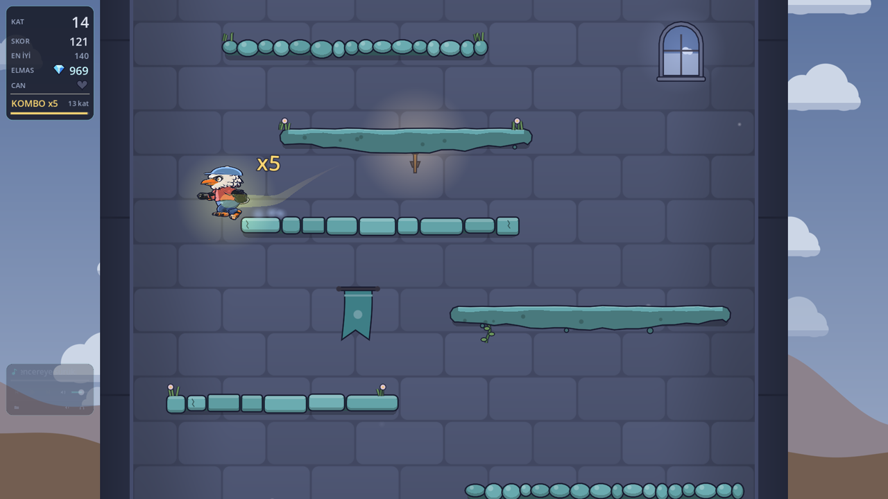
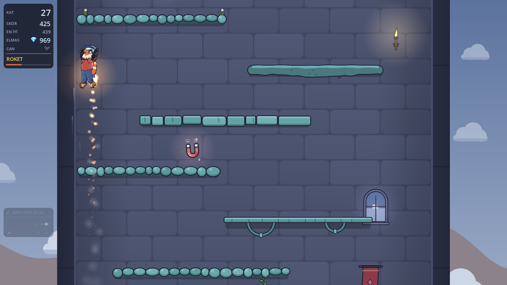
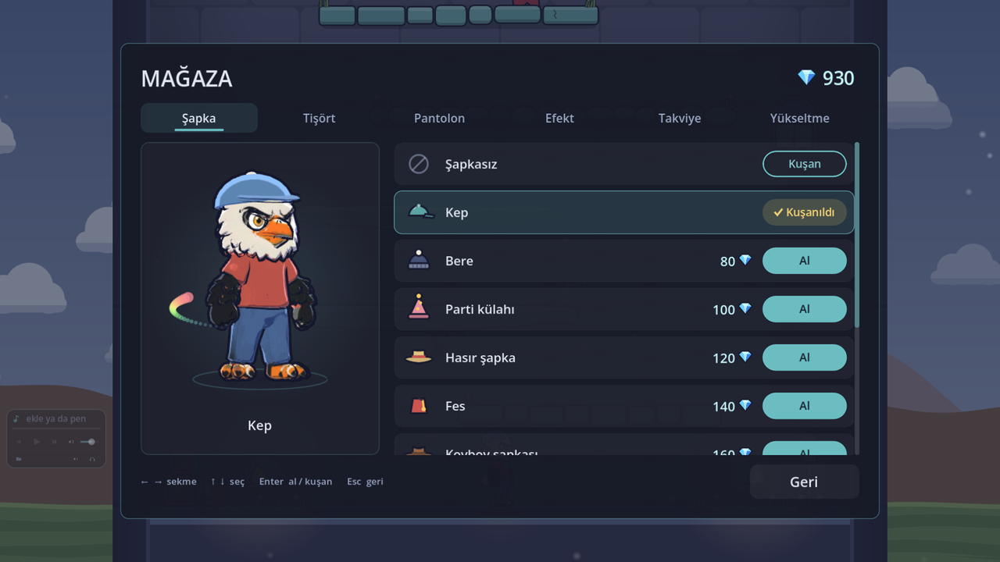
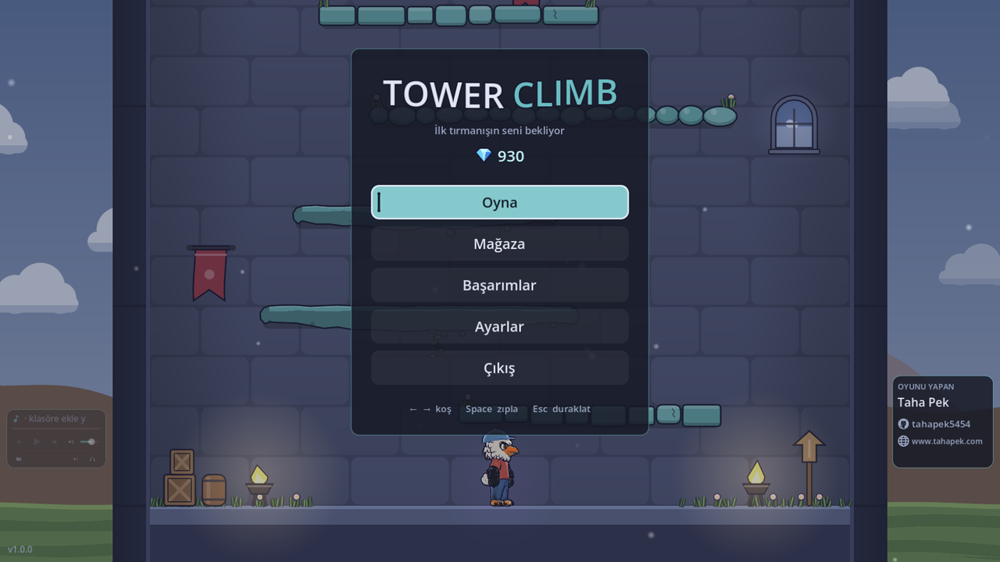

# Tower Climb

**Hız kazan, zıpla, duvardan sek, kuleyi tırman. Kamera seni bekleyip durmaz.**

Tower Climb, Godot 4 ile yapılmış 2D, sonsuz bir kule tırmanma oyunu. Kartal kahramanını sağa sola koşturup platformdan platforma zıplatıyorsun. Ne kadar hızlı koşarsan o kadar yükseğe zıplıyorsun. Kamera giderek hızlanarak yukarı kayıyor; ekranın altında kalırsan oyun bitiyor.

> *English:* Tower Climb is a free, open-source 2D endless tower climber made with Godot 4. Build momentum, chain multi-floor combos, bounce off walls and climb as high as you can before the rising camera catches you. The UI is in Turkish.



| | |
|---|---|
|  |  |
|  | **[⬇ Windows için indir](https://github.com/tahapek5454/Tower-Climb/releases/latest)** |


---

## Nasıl oynanır

| Eylem | Tuş |
|---|---|
| Sola / sağa koş | `←` `→` veya `A` `D` |
| Zıpla (basılı tut = daha yüksek) | `Space`, `↑` veya `W` |
| Duraklat | `Esc` |
| Tam ekran | `F11` veya `Alt` + `Enter` |
| Sesi kapat / aç | `M` |
| Yeniden başla (oyun bitince) | `R` veya `Space` |
| Menüler | Ok tuşları + `Enter` / `Esc`, fare de çalışır |

**İpuçları**
- Zıplamadan önce hız kazan: tam hızda zıplama, durarak zıplamanın iki katından da yükseğe çıkar.
- Duvara hızlı çarparsan sekersin ve taklayla biraz daha yükselirsin.
- Tek zıplayışta **2 veya daha fazla kat** atlarsan kombo başlar. Komboyu süre dolmadan sürdür; kombo puanı atlanan katların **karesi** kadar.
- Her 100 katta bir bölüm platformu gelir, tema değişir ve kamera biraz daha hızlanır.

## Özellikler

- **Momentuma dayalı fizik:** elle yazılmış hareket, coyote time, zıplama tamponu, değişken zıplama yüksekliği, duvar sekmesi.
- **Sonsuz kule:** platformlar yükseldikçe daralır ve her zaman ulaşılabilir yerlere konur. Yüksek katlarda çatlayan, kayan ve buzlu platformlar çıkar.
- **Kombo ve skor:** kombo çarpanı, büyük kombolarda elmas ödülü, ekranda rekor çizgisi.
- **Güçlendirmeler:** roket (yukarı uçur), kalp (düşünce seni kurtarır), kum saati (kamerayı yavaşlatır), mıknatıs (elmasları çeker).
- **Elmas mağazası:** şapkalar, tişört ve pantolon desenleri, iz efektleri, kalıcı yükseltmeler, tek kullanımlık takviyeler ve elmasla devam etme hakkı.
- **15 başarım:** her biri elmas ödüllü.
- **Bol efekt:** takla ve silindirik dönüş, squash & stretch, iz, iniş tozu, ekran sarsıntısı, hit-stop, parıltılar.
- **3D karakter, 2D dünya:** kartal modeli toon shader ve dış çizgiyle 2D sahneye çiziliyor.
- **Kendi müziğin:** masaüstü sürümünde radyo paneli kendi müzik klasörünü çalar (mp3 / ogg / wav). Oyunla birlikte müzik gelmez.
- **Ayarlar:** ses kanalları, tam ekran, ekran sarsıntısı, odak kaybında duraklatma. Rekorlar ve ayarlar kaydedilir.

## İndir ve oyna

1. [Son sürümün sayfasından](https://github.com/tahapek5454/Tower-Climb/releases/latest) `TowerClimb-v1.0.0-windows.zip` dosyasını indir.
2. Zip'i bir klasöre çıkar ve `TowerClimb.exe`'yi çalıştır. Kurulum gerekmez (Windows 10/11, 64 bit).
3. Windows "Bilgisayarınız korundu" uyarısı gösterirse **Ek bilgi → Yine de çalıştır**'a tıkla. Exe imzasız olduğu için bu uyarı çıkıyor.

## Kaynaktan çalıştır

1. [Godot 4.7](https://godotengine.org/download)'yi indir. **Standard** sürüm yeterli, .NET sürümü gerekmez.
2. Depoyu klonla:
   ```bash
   git clone https://github.com/tahapek5454/Tower-Climb.git
   ```
3. Godot'da **Import** ile `project.godot` dosyasını aç, sonra `F5` ile çalıştır.

Editörde ve debug yapılarda geliştirici tuşları da açıktır: `F3` debug paneli, `F4` yavaş çekim, `F6` sonraki bölüme ışınlanma, `F7`–`F10` güçlendirme koyma. Yayın (release) sürümünde bu tuşlar yoktur.

### Testler

Saf oyun kuralları (skor, kombo, platform üretimi, mağaza, güçlendirmeler…) [GUT](https://github.com/bitwes/Gut) ile test ediliyor:

```bash
godot --headless --path . -s res://addons/gut/gut_cmdln.gd
```

Sonda `All tests passed` görünmeli.

## Proje yapısı

```
scenes/    sahneler (main.tscn, oyuncu, dünya, arayüz, efektler)
scripts/   tuning.gd (tüm oynanış sayıları), autoload/, game/ (saf kurallar),
           player/, world/, ui/, fx/
assets/    modeller, shader'lar, sesler
tests/     GUT testleri
tools/     ses sentezi (tools/sfx), Blender betikleri (tools/blender), simge üretici (tools/icon)
docs/      tasarım belgesi ve geliştirme günlüğü
```

Birkaç tasarım kararı:
- **Fizik ve görüntü ayrı.** `Player` (CharacterBody2D) yalnız hareketi yönetir ve durum sinyalleri yayınlar. Taklalar, efektler ve 3D model `Visual` katmanında bu sinyalleri dinler.
- **Sihirli sayı yok.** Bütün oynanış değerleri `scripts/tuning.gd`'de. Ayrıntılar [`docs/GAME_DESIGN.md`](docs/GAME_DESIGN.md)'de.
- **Sesler kodla üretiliyor.** Tüm ses efektleri `tools/sfx/generate_sfx.py` ile sentezlendi, dışarıdan ses dosyası yok.

## Krediler ve lisans

Kod [MIT lisansı](LICENSE) ile dağıtılıyor. Karakter modeli, araçlar ve diğer kaynakların lisansları [`CREDITS.md`](CREDITS.md)'de.

Yapan: **Taha Pek** · [github.com/tahapek5454](https://github.com/tahapek5454) · [tahapek.com](https://www.tahapek.com)
